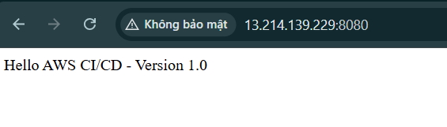

This section verifies that the CI/CD pipeline builds, tests, and deploys the web application successfully. It also demonstrates how to inspect build logs, deployment events, and application availability.

## 1. Verify the CodePipeline Execution

1. Open the **AWS CodePipeline** console.
2. Select the pipeline created for the `cicd-aws-demo` project.
3. Review the status of each stage:
    - **Source:** Retrieves the source code from GitHub.
    - **Build:** Builds the Spring Boot application and runs the configured tests.
    - **Deploy:** Deploys the application to the EC2 instance using CodeDeploy.
4. Confirm that all configured stages display **Succeeded**.
5. Open the latest execution and record its status for the project report.

If a stage fails, select the failed stage and inspect its details before proceeding.

## 2. Test the Build with AWS CodeBuild

1. Open the **AWS CodeBuild** console.
2. Select the build project `cicd-aws-demo-build`.
3. Open the latest build execution.
4. Review the build logs and check the following:
    - Maven dependencies are downloaded successfully.
    - Unit tests execute without failures.
    - The application package is generated.
    - The build completes with a successful status.

To verify the build locally, open PowerShell in the Spring Boot project directory and run:

```powershell
.\mvnw.cmd clean test package
```

A successful Maven build should finish without compilation errors or test failures.

If the build fails, inspect the first relevant error in the logs. Common causes include an incorrect Java version, failing tests, missing dependencies, or an invalid `buildspec.yml`.

## 3. Verify the CodeDeploy Deployment

1. Open the **AWS CodeDeploy** console.
2. Select the application `cicd-aws-demo-app`.
3. Open the deployment group `cicd-aws-demo-deployment-group`.
4. Select the latest deployment.
5. Check the deployment status and lifecycle events.

The deployment should display **Succeeded** if all required deployment steps complete successfully.

If the deployment fails, open the failed lifecycle event and inspect its error message. Check the AppSpec file, deployment scripts, file permissions, and CodeDeploy agent status.

## 4. Test the Web Application

After a successful deployment, test the application from a browser.

1. Open the **Amazon EC2** console.
2. Select the EC2 instance hosting the application.
3. Copy its public IPv4 address, if


