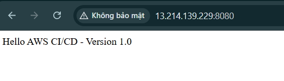

Phần này nhằm xác minh rằng quy trình CI/CD có thể xây dựng, kiểm thử và triển khai ứng dụng web thành công. Đồng thời, phần này cũng hướng dẫn cách kiểm tra build logs, deployment events và tình trạng hoạt động của ứng dụng.

## 1. Xác minh quá trình thực thi CodePipeline

1. Mở **AWS CodePipeline** Console.
2. Chọn pipeline đã tạo cho dự án `cicd-aws-demo`.
3. Kiểm tra trạng thái của từng giai đoạn:
    - **Source:** Lấy mã nguồn từ GitHub.
    - **Build:** Xây dựng ứng dụng Spring Boot và chạy các bài kiểm thử đã cấu hình.
    - **Deploy:** Triển khai ứng dụng lên EC2 instance bằng CodeDeploy.
4. Xác nhận tất cả các giai đoạn đã cấu hình đều hiển thị trạng thái **Succeeded**.
5. Mở lần thực thi gần nhất và ghi lại trạng thái để đưa vào báo cáo thực tập.

Nếu một giai đoạn thất bại, hãy chọn giai đoạn đó và kiểm tra thông tin chi tiết trước khi tiếp tục.

## 2. Kiểm thử quá trình Build bằng AWS CodeBuild

1. Mở **AWS CodeBuild** Console.
2. Chọn build project `cicd-aws-demo-build`.
3. Mở lần thực thi build gần nhất.
4. Kiểm tra build logs và xác nhận các nội dung sau:
    - Các thư viện phụ thuộc của Maven được tải xuống thành công.
    - Các bài kiểm thử đơn vị (Unit Tests) được thực thi mà không xảy ra lỗi.
    - Gói ứng dụng được tạo thành công.
    - Quá trình build hoàn tất với trạng thái thành công.

Để xác minh quá trình build trên máy cục bộ, mở PowerShell tại thư mục dự án Spring Boot và chạy lệnh:

```powershell
.\mvnw.cmd clean test package
```

Quá trình build Maven thành công khi hoàn tất mà không có lỗi biên dịch hoặc lỗi kiểm thử.

Nếu quá trình build thất bại, hãy kiểm tra lỗi liên quan đầu tiên trong logs. Các nguyên nhân phổ biến bao gồm phiên bản Java không chính xác, bài kiểm thử thất bại, thiếu thư viện phụ thuộc hoặc tệp `buildspec.yml` không hợp lệ.

## 3. Xác minh quá trình triển khai bằng CodeDeploy

1. Mở **AWS CodeDeploy** Console.
2. Chọn ứng dụng `cicd-aws-demo-app`.
3. Mở Deployment Group `cicd-aws-demo-deployment-group`.
4. Chọn lần triển khai gần nhất.
5. Kiểm tra trạng thái triển khai và các sự kiện trong vòng đời triển khai (Lifecycle Events).

Quá trình triển khai sẽ hiển thị trạng thái **Succeeded** nếu tất cả các bước triển khai cần thiết hoàn tất thành công.

Nếu quá trình triển khai thất bại, hãy mở sự kiện trong vòng đời bị lỗi và kiểm tra thông báo lỗi. Kiểm tra tệp AppSpec, các deployment script, quyền truy cập tệp và trạng thái của CodeDeploy Agent.

## 4. Kiểm thử ứng dụng Web

Sau khi triển khai thành công, hãy kiểm tra ứng dụng bằng trình duyệt.

1. Mở **Amazon EC2** Console.
2. Chọn EC2 instance đang lưu trữ ứng dụng.
3. Sao chép địa chỉ IPv4 công khai (Public IPv4 address) của instance.

